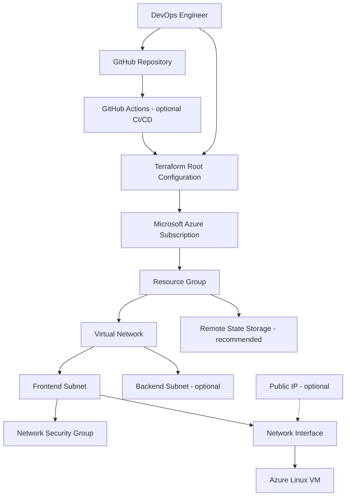
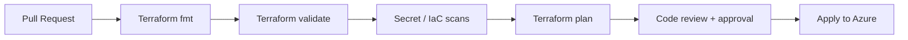

Provision a secure, repeatable Azure infrastructure foundation with Terraform using a monolithic root-module approach. Built as a hands-on DevOps portfolio project demonstrating infrastructure as code, cloud networking, governance, and CI/CD practices.

📌 Project Overview
This project demonstrates how to provision an Azure Landing Zone using Terraform. It follows a monolithic architecture: related infrastructure resources are managed together from one Terraform root configuration and state, rather than separate independently deployed modules or stacks.
Core goals
- Provision infrastructure consistently through version-controlled Terraform.
- Establish foundational networking and compute resources on Azure.
- Use reusable input variables and environment-specific values.
- Validate and review infrastructure changes before deployment.
- Evolve toward security-first, automated delivery.
Scope note: This is a landing-zone foundation / learning implementation, not a claim of full alignment with every Azure Landing Zone enterprise-scale design requirement. Validate the resource list below against the actual .tf files in this repository.

🏗️ High-Level Architecture

Diagram is a reference architecture; optional components should be included only if present in your deployment.
🧩 Infrastructure Components
Component	Purpose	Typical Terraform resource
Resource Group	Logical container for resources	azurerm_resource_group
Virtual Network	Private network boundary	azurerm_virtual_network
Subnet	Network segmentation	azurerm_subnet
Network Security Group	Inbound/outbound traffic controls	azurerm_network_security_group
Network Interface	Connects VM to subnet	azurerm_network_interface
Public IP (optional)	Controlled external connectivity	azurerm_public_ip
Linux VM	Compute workload	azurerm_linux_virtual_machine
Storage Account (recommended)	Terraform remote state backend	azurerm_storage_account

🧠 Why Monolithic Terraform?
All resources are declared under a single root module and generally share one Terraform state and deployment lifecycle.
Advantages: simple initial setup, clear dependency graph, centralized change review, and quick development for small environments.
Trade-offs: larger state blast radius, slower plans as infrastructure grows, tighter coupling, and limited independent deployments. For multi-team or multi-environment enterprise use, split into separately managed stacks or modules when appropriate.
📁 Suggested Repository Structure
Adjust this tree to match your real repository before publishing.

azure-monolithic-landing-zone/
├── .github/
│   └── workflows/
│       └── terraform.yml          # Optional CI/CD pipeline
├── .gitignore
├── .gitleaks.toml                 # Optional custom secret-scan config
├── README.md
├── versions.tf                    # Terraform and provider requirements
├── provider.tf                    # Azure provider configuration
├── backend.tf                     # Remote state backend (if configured)
├── main.tf                        # Main resource definitions
├── variables.tf                   # Input variable declarations
├── terraform.tfvars.example       # Safe example values
└── outputs.tf                     # Useful deployment outputs
Terraform files can be organized differently while remaining monolithic, as long as they belong to the same root module/state.
🛠️ Prerequisites
- An Azure subscription with permissions to provision the target resources.
- Terraform installed.
- Azure CLI installed.
- Git and a GitHub account.
- A configured remote backend, if your project uses one.
🚀 Getting Started
1. Clone the repository
git clone https://github.com/<YOUR_USERNAME>/<YOUR_REPOSITORY>.git
cd <YOUR_REPOSITORY>
2. Authenticate to Azure
az login
az account list --output table
az account set --subscription "<SUBSCRIPTION_ID>"
For local execution, use an identity with least-privilege access. In CI/CD, prefer OIDC workload identity federation over stored client secrets.
3. Configure variables
Create a local terraform.tfvars based on the variables actually declared in variables.tf. Example only:
location            = "centralindia"
resource_group_name = "rg-landingzone-dev"
vnet_cidr           = "10.10.0.0/16"
subnet_cidr         = "10.10.1.0/24"
vm_size             = "Standard_B2s"
Variable names above are illustrative. Replace them with your actual input names. Never commit passwords, access keys, tokens, or real .tfvars files containing secrets. Prefer SSH keys and secure secret stores over VM passwords.

4. Initialize and validate
terraform init
terraform fmt -check -recursive
terraform validate
5. Review and deploy
terraform plan -out=tfplan
terraform apply tfplan
Always review the plan for unexpected resource replacement, exposed ports, and cost implications before applying.
6. Inspect outputs
terraform output
7. Clean up lab resources
terraform plan -destroy
terraform destroy
Destroy only resources you own and intend to remove. Check for dependencies and data-retention requirements first.
🔄 CI/CD Workflow (Recommended)
A production-minded GitHub Actions workflow should separate pull-request checks from approved deployment:

Suggested quality gates
1. terraform fmt -check -recursive
2. terraform init -backend=false and terraform validate for static validation
3. Gitleaks for secret detection
4. Checkov or another IaC policy scanner
5. Terraform plan for the target environment (with backend and Azure authentication configured)
6. Manual approval / protected environment before apply
CI/CD and scanning are recommended capabilities, not verified as implemented in this repository. Configure GitHub OIDC, scoped Azure RBAC, branch protection, and environment approvals before enabling automated apply.

🔐 Security & Governance Considerations
- Identity: least-privilege RBAC; avoid permanent service-principal secrets.
- Network: deny-by-default NSGs; do not expose SSH/RDP to 0.0.0.0/0.
- VM access: prefer Azure Bastion or private access and SSH-key authentication.
- State: use an Azure Storage remote backend with restricted access and state locking; treat state as sensitive.
- Secrets: use Key Vault or approved CI secrets management; never hardcode credentials.
- Governance: apply consistent tags, naming conventions, policy controls, and cost budgets.
- Observability: consider Azure Monitor, Log Analytics, diagnostic settings, and alerts.
🧪 Validation Checklist
- [ ] Terraform formatting passes.
- [ ] Terraform validation passes.
- [ ] Plan shows only intended changes.
- [ ] VNet/subnet address ranges do not overlap.
- [ ] NSG rules permit only necessary traffic.
- [ ] No credentials or state files are committed.
- [ ] Azure resource names and regions are correct.
- [ ] VM SKU is available in the selected region.
- [ ] Remote state and CI/CD identity are configured where applicable.
- [ ] Outputs contain no unnecessary sensitive information.
🩺 Troubleshooting
Symptom	Likely cause	First check
AuthorizationFailed	Insufficient Azure RBAC permissions	az account show and assigned roles
ResourceNotFound	Incorrect name, resource group, or dependency	Terraform references and Azure resource IDs
VM SKU unavailable	Region/SKU restrictions or quota	Available VM sizes and subscription quota
Backend initialization fails	Storage permissions, network restrictions, or config	Backend settings and Azure identity
Terraform reports drift	Manual changes made in Azure	terraform plan and change history
Secret scan fails	Credential accidentally committed	Rotate/revoke secret and clean repository history

📈 Future Enhancements
- [ ] GitHub Actions pipeline with OIDC-based Azure authentication
- [ ] Remote Terraform state with protected Azure Storage backend
- [ ] Gitleaks + Checkov security gates
- [ ] Azure Policy and management-group governance
- [ ] Private networking, Azure Bastion, and Key Vault integration

🎯 Talking Points
“I built an Azure landing-zone foundation using Terraform in a monolithic architecture. I defined networking and compute infrastructure as code, used Terraform's plan-and-apply workflow for controlled provisioning, and focused on reproducibility and security. The monolithic design made the initial deployment straightforward, while also highlighting limitations around shared state, deployment coupling, and blast radius. My next step is to mature it with remote state, CI/CD security gates, and independently deployable Terraform modules.”

- [ ] Centralized logging and monitoring
- [ ] Modular Terraform architecture for independent deployments
- [ ] Multi-environment deployment strategy (dev/test/prod)
